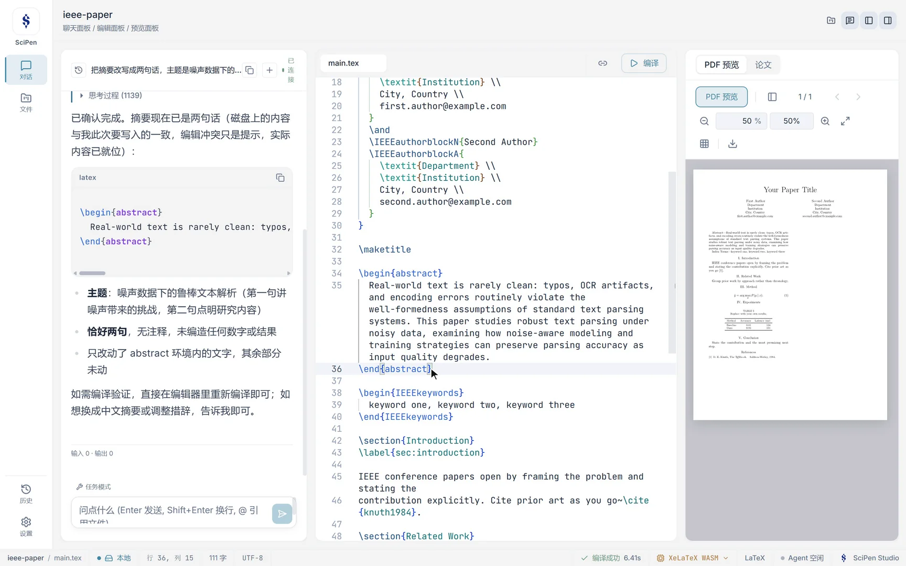
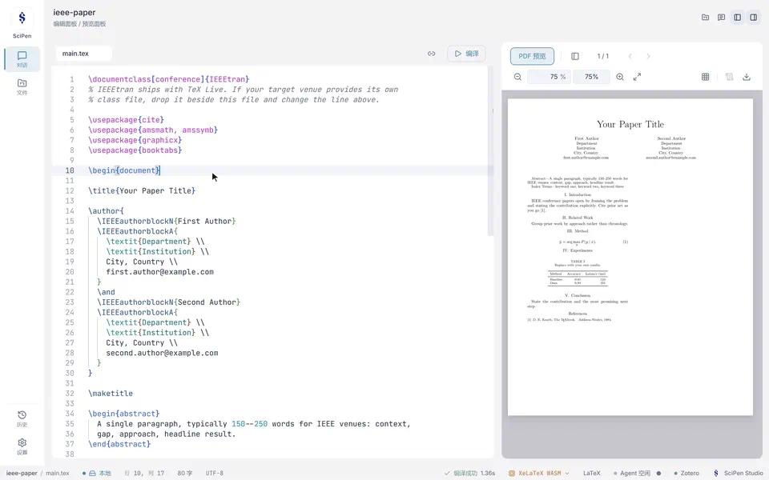
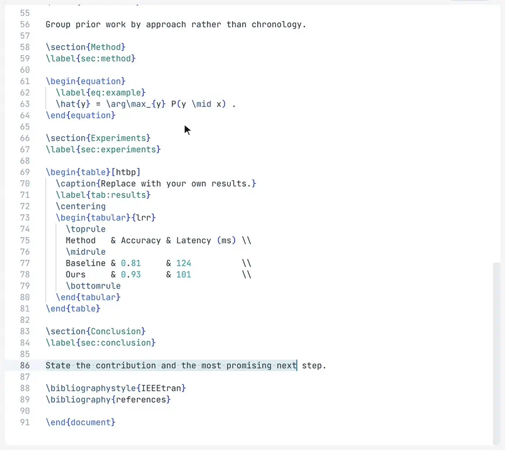
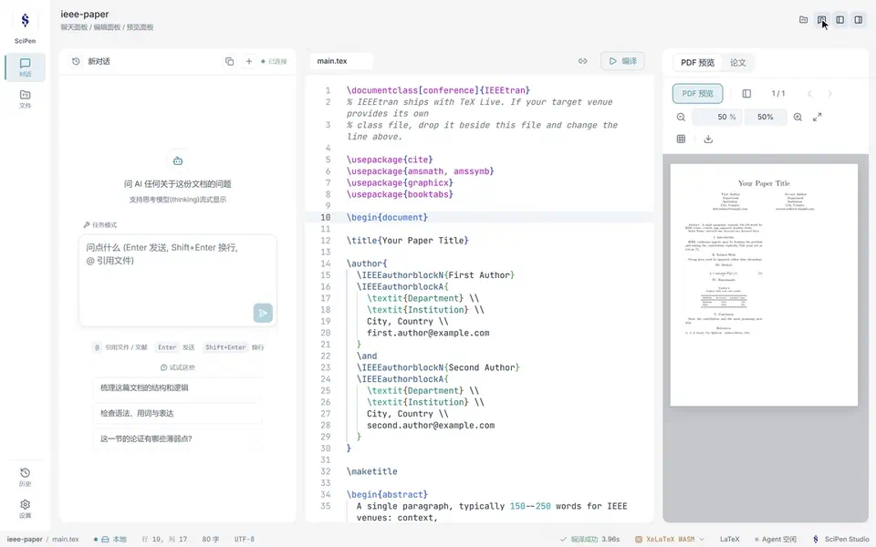
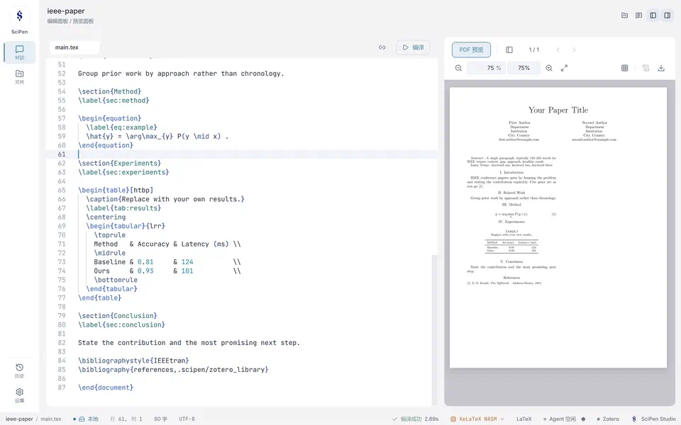
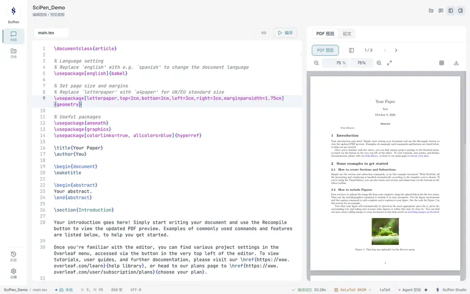
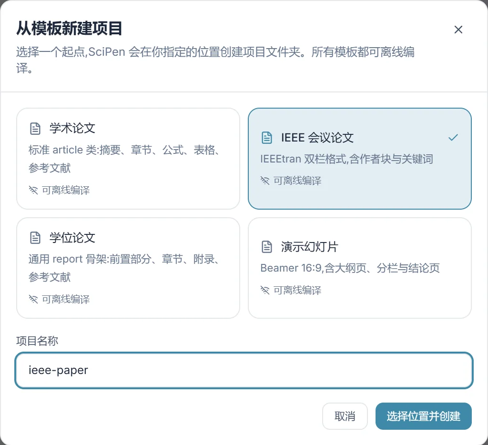

<p align="center">
  
</p>

<h1 align="center">SciPen Studio</h1>

<p align="center">
  <strong>Research writing like Vibe Coding — a local-first desktop IDE for LaTeX &amp; Typst.</strong>
</p>

<p align="center">
  Write and compile completely offline (including Chinese <code>ctex</code>) in sub-second WASM, cite via Zotero semantic search, review AI edits hunk by hunk with the built-in Rust Agent, and sync cleanly with Overleaf.
</p>

<p align="center">
  <a href="https://github.com/scipenai/scipen-studio/releases"></a>
  <a href="https://github.com/scipenai/scipen-studio/releases"></a>
  <a href="./LICENSE"></a>
  <a href="https://scipen.ai"></a>
</p>

<p align="center">
  <a href="https://scipen.ai">Website</a> ·
  <a href="https://github.com/scipenai/scipen-studio/releases">Download</a> ·
  <a href="docs/USER_GUIDE.md">User Guide</a> ·
  <a href="DEVELOPER.md">Developer Guide</a> ·
  <a href="CHANGELOG.md">Changelog</a>
</p>

<p align="center"><strong>English</strong> · <a href="README.zh-CN.md">简体中文</a></p>

<p align="center">
  
</p>

<p align="center">
  <sub>Three-pane desktop workspace (recorded in Chinese UI): built-in SNACA Agent chat on the left, Monaco LaTeX editor with TexLab in the center, and live PDF preview with SyncTeX on the right.</sub>
</p>

---

## See It in Action

### 1. Zero-Install Offline Compile & Two-Way SyncTeX

Run [BusyTeX](https://github.com/busytex/busytex) (`pdftex` / `xetex` / `lualatex`) in an isolated Electron UtilityProcess alongside [typst.ts](https://github.com/Myriad-Dreamin/typst.ts), or switch to a local Tectonic, TeX Live, or Typst CLI automatically. Incremental builds reuse clean `.aux` / `.toc` / `.bbl` artifacts across edits, while `texlive-cjk.data` bundles `ctex`, `xeCJK`, `zhnumber`, and Fandol OpenType fonts — with a one-click CodeLens inserting portable `\usepackage[fontset=fandol]{ctex}` when Chinese text is detected.

<p align="center">
  
</p>

<p align="center">
  <sub>Real capture (Chinese UI): edit title → press <code>Ctrl+Enter</code> → click source with <code>Ctrl+Click</code> to locate the exact region in the PDF.</sub>
</p>

### 2. Built-in Research AI Agent & `Ctrl+K` Inline Edits

Edit directly in context with `Ctrl+K` streaming rewrites right beside your original lines (`Tab` to accept, `Esc` to dismiss), or work across files with the embedded [SNACA](https://github.com/scipenai/snaca) Rust runtime: hunk-level Diff Review (*Accept All* or per-hunk ✓/✗), interactive `AskUserQuestion` cards, per-project Markdown Memory, MCP tools, WebFetch / Tavily WebSearch, 4 bundled [academic-research-skills](https://github.com/Imbad0202/academic-research-skills), BYOK OpenAI / Anthropic endpoints, and optional global selection capture (`Alt+D` / `Ctrl+L`).

<p align="center">
  
</p>

<p align="center">
  <sub>Real capture (Chinese UI): select a conclusion sentence → press <code>Ctrl+K</code> → review the inline diff → press <code>Tab</code> to accept.</sub>
</p>

<details>
<summary>Watch full 3-pane Agent rewrite &amp; Diff Review workflow (22 s capture)</summary>

<p align="center">
  
</p>

<p align="center">
  <sub>Recorded in SciPen Studio 0.5.1 (Chinese UI) with model/compile waits trimmed. Note: in 0.5.1 the Diff Review addition pane showed original text until accepted, after which the Agent's rewrite was written to disk cleanly.</sub>
</p>

</details>

### 3. Zotero Citations, CiteShot Previews & Paper Reader

Connect to desktop Zotero (via Better BibTeX) or zotero.org Cloud Web API for live `@cite` / `\cite{` completion, active semantic citation recommendations while typing, CiteShot hover abstract previews, local embedding search over PDFs, grounded Agent tools (`zotero_search`, `zotero_lookup`, `zotero_annotations`, `zotero_read`), and a right-pane Paper viewer (`Ctrl+Click` any citation to inspect the referenced PDF beside your draft).

<p align="center">
  
</p>

<p align="center">
  <sub>Real capture (CC BY 4.0 arXiv demo library, Chinese UI): type <code>\cite{</code> → pick reference → recompile → hover for bibliographic &amp; paper preview → <code>Ctrl+Click</code> to open full PDF.</sub>
</p>

### 4. Local-First Overleaf 3-Way Sync & Git-Free History

Open Overleaf projects locally for instant offline editing and compiling without fighting web timeouts; changes push asynchronously with three-way merge (`base / local / remote`) and clear conflict resolution. Underneath, content-addressed local snapshots capture manual labels, compile milestones, AI drift checkpoints, and per-message chat Rollback — all without exposing Git complexity.

<p align="center">
  
</p>

<p align="center">
  <sub>Real capture (two clips joined, Chinese UI): edit and compile an Overleaf project locally with <code>Ctrl+S</code> → verify updated source and PDF synced to overleaf.com.</sub>
</p>

---

## Quick Start

1. Download the installer for **Windows**, **macOS** (Intel / Apple Silicon), or **Linux** (AppImage / `.deb`) from [GitHub Releases](https://github.com/scipenai/scipen-studio/releases).
2. On first launch, pick **New from template** (`article`, `ieee` with bundled `IEEEtran.bst`, `thesis`, `beamer` — all verified offline) or **Open local project** on any existing `.tex` / `.typ` / `.md` folder.
3. Open a `.tex` file and press `Ctrl+Enter` to compile with the bundled WASM engine (switch `pdftex` / `xetex` / `lualatex` in the bottom-right status bar; choose `xetex` for Chinese `ctex` documents).
4. AI chat (*Settings → AI*), Zotero (*Settings → Zotero*), and Overleaf sync (*Cloud project*) are optional — drafting and offline compiling work immediately with zero API keys.

<p align="center">
  
</p>

<details>
<summary>First launch note for unsigned macOS &amp; Windows installers</summary>

- **macOS Gatekeeper**: Unsigned builds may show *"App is damaged / can't be opened"*. Either right-click `SciPen Studio.app` → **Open** → confirm **Open**, or run in Terminal:
  ```bash
  xattr -dr com.apple.quarantine "/Applications/SciPen Studio.app"
  ```
- **Windows SmartScreen**: Click **More info → Run anyway**.

</details>

<details>
<summary>Build from source (Node.js 20+ &amp; npm 10+)</summary>

```bash
# SNACA agent ships as a git submodule; clone with --recurse-submodules
# (or run `git submodule update --init --recursive` after a plain clone).
git clone --recurse-submodules https://github.com/scipenai/scipen-studio.git
# Bundled academic Skills live in a sibling directory; clone it next to scipen-studio.
git clone https://github.com/Imbad0202/academic-research-skills.git

cd scipen-studio
npm install
npm run prebuild   # download LSPs + BusyTeX (incl. CJK pack) + Typst WASM + build SNACA + stage skills
npm run dev
```

`prebuild` is the one-time bootstrap required before `dev` (`npm run setup` only downloads LSP binaries). If `academic-research-skills` lives elsewhere, set `ARS_SKILLS_DIR=<path>` (or `SCIPEN_SKIP_SKILLS=1` to skip bundling skills).

To verify BusyTeX offline templates and production CJK behavior locally:

```bash
npm run build:workers && npm run verify:busytex
```

See [CONTRIBUTING.md](CONTRIBUTING.md) and [DEVELOPER.md](DEVELOPER.md) for packaging (`build:win`, `build:mac`, `build:linux`), tests, and IPC details.

</details>

---

## Documentation & Community

- [Official Website](https://scipen.ai) — product overview and downloads
- [User Guide](docs/USER_GUIDE.md) — feature walkthrough, Zotero / AI / Overleaf setup, and shortcuts
- [Developer Guide](DEVELOPER.md) — architecture, IPC contracts, BusyTeX WASM pipeline, and testing
- [Contributing](CONTRIBUTING.md) · [Code of Conduct](CODE_OF_CONDUCT.md) · [Security Policy](SECURITY.md) · [Changelog](CHANGELOG.md)
- [GitHub Releases](https://github.com/scipenai/scipen-studio/releases) · [Issues](https://github.com/scipenai/scipen-studio/issues) · [Discussions](https://github.com/scipenai/scipen-studio/discussions)

## Built On

SciPen Studio builds on the work of these open-source projects:

- [SNACA](https://github.com/scipenai/snaca) — the built-in Rust agent runtime (sibling scipenai project, embedded as a git submodule)
- [Electron](https://www.electronjs.org/) & [electron-vite](https://electron-vite.org/) — desktop runtime and build pipeline
- [Monaco Editor](https://microsoft.github.io/monaco-editor/) — the editor that powers the writing surface
- [BusyTeX](https://github.com/busytex/busytex) & [TeXlyre BusyTeX](https://github.com/TeXlyre/texlyre-busytex) — the bundled WebAssembly TeX engine (`pdftex` / `xetex` / `lualatex`)
- [typst.ts](https://github.com/Myriad-Dreamin/typst.ts) — the bundled WebAssembly Typst engine
- [TexLab](https://github.com/latex-lsp/texlab), [Tinymist](https://github.com/Myriad-Dreamin/tinymist), [Marksman](https://github.com/artempyanykh/marksman) — language servers for LaTeX, Typst, and Markdown
- [pdf.js](https://github.com/mozilla/pdf.js) — PDF rendering and CMap support
- [KaTeX](https://katex.org/) — inline math preview
- [diff-match-patch](https://github.com/google/diff-match-patch) — hunk-level diff for AI review
- [Better BibTeX](https://retorque.re/zotero-better-bibtex/) — the Zotero plugin that exposes the library to the app
- [academic-research-skills](https://github.com/Imbad0202/academic-research-skills) — bundled SNACA Skills (`academic-paper`, `academic-paper-reviewer`, `academic-pipeline`, `deep-research`)
- [Tectonic](https://tectonic-typesetting.github.io/) & [TeX Live](https://www.tug.org/texlive/) — optional full TeX distributions

Thanks to everyone maintaining the upstream projects that make SciPen Studio possible.

## License

[MIT](./LICENSE) © SciPen Team
