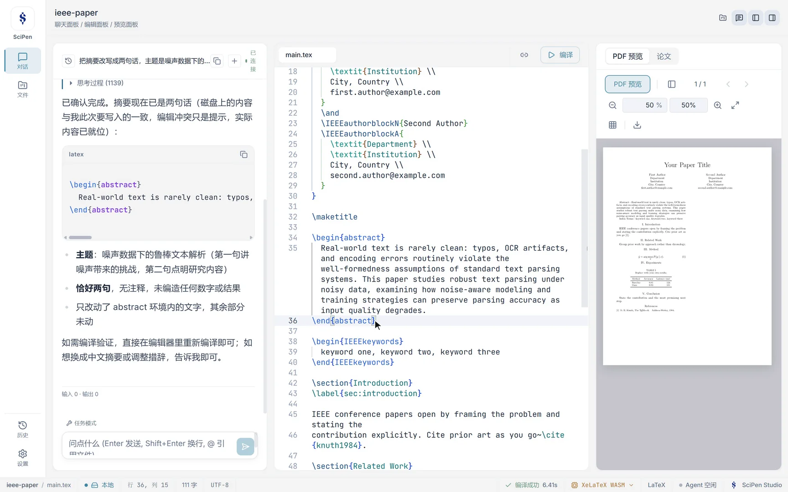
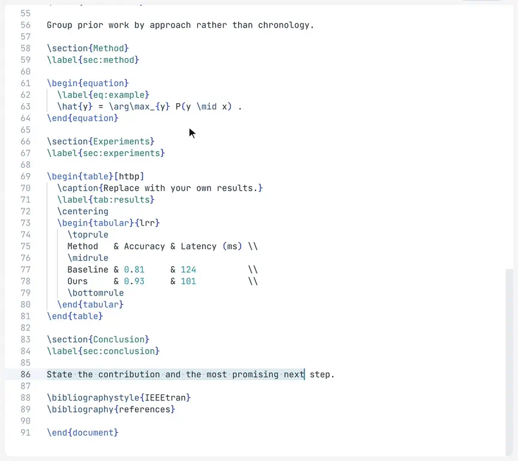
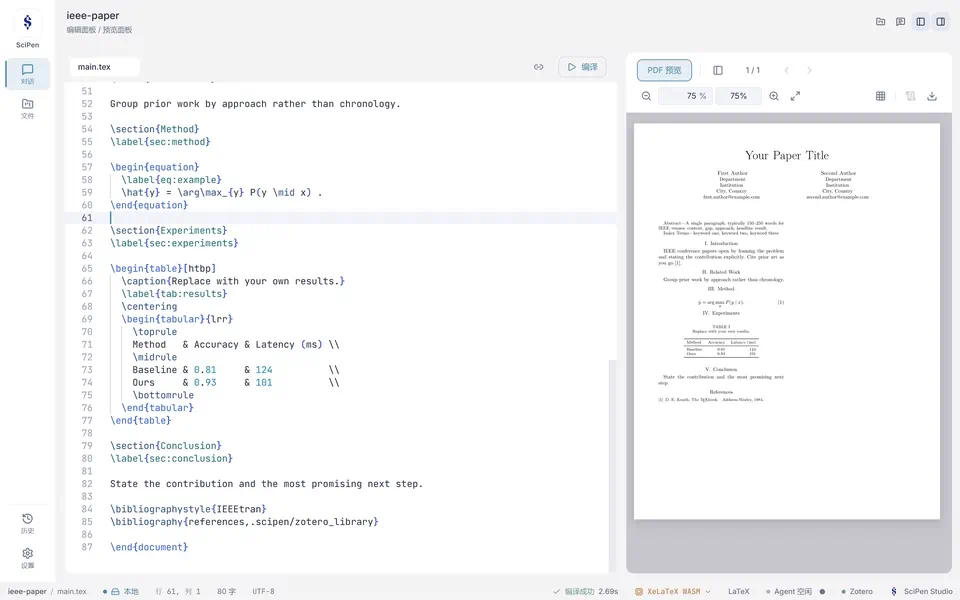

<p align="center">
  
</p>

<h1 align="center">SciPen Studio</h1>

<p align="center">
  <strong>像 Vibe Coding 一样做科研 — 本地优先的 LaTeX 与 Typst AI 桌面 IDE。</strong>
</p>

<p align="center">
  无需安装多 GB 本地 TeX 发行版，内置亚秒级 WASM 离线编译（含中文 <code>ctex</code>）、Zotero 语义引文、内置 Rust AI Agent 逐块 Diff 审阅与 Overleaf 三方同步，草稿与历史稳妥留在本地磁盘。
</p>

<p align="center">
  <a href="https://github.com/scipenai/scipen-studio/releases"></a>
  <a href="https://github.com/scipenai/scipen-studio/releases"></a>
  <a href="./LICENSE"></a>
  <a href="https://scipen.ai"></a>
</p>

<p align="center">
  <a href="https://scipen.ai">官网</a> ·
  <a href="https://github.com/scipenai/scipen-studio/releases">下载安装包</a> ·
  <a href="docs/USER_GUIDE.zh-CN.md">用户手册</a> ·
  <a href="DEVELOPER.md">开发者文档</a> ·
  <a href="CHANGELOG.md">更新日志</a>
</p>

<p align="center"><a href="README.md">English</a> · <strong>简体中文</strong></p>

<p align="center">
  
</p>

<p align="center">
  <sub>三栏同屏桌面工作区：左侧内置 SNACA Agent 对话面板，中间为集成 TexLab 的 Monaco 源码编辑器，右侧支持双向 SyncTeX 实时 PDF 预览。</sub>
</p>

---

## 功能实录

### 1. 开箱离线编译与双向 SyncTeX 定位

在独立 Electron UtilityProcess 中运行 [BusyTeX](https://github.com/busytex/busytex)（`pdftex` / `xetex` / `lualatex`）并与 [typst.ts](https://github.com/Myriad-Dreamin/typst.ts) 并行调度，同时支持自动检测本机 Tectonic、TeX Live 与 Typst CLI。跨轮增量流水线自动复用干净 `.aux` / `.toc` / `.bbl` 产物；内置 `texlive-cjk.data` 打包 `ctex`、`xeCJK`、`zhnumber` 与 Fandol OpenType 字体，并在检测到中文正文时提供一键 CodeLens 插入标准可移植的 `\usepackage[fontset=fandol]{ctex}`。

<p align="center">
  
</p>

<p align="center">
  <sub>实录操作：修改论文标题 → <code>Ctrl+Enter</code> 触发编译 → 按住 <code>Ctrl</code> 单击源码行，右侧 PDF 对应位置即时高亮闪烁定位。</sub>
</p>

### 2. 内置科研 AI Agent 与 `Ctrl+K` 就地改写

选中任意段落按 `Ctrl+K`，AI 改写建议直接在原文旁流式呈现（`Tab` 接受、`Esc` 取消）；需要跨文件或长流程协作时，内置 [SNACA](https://github.com/scipenai/snaca) Rust 运行时提供逐 hunk 彩色 Diff 审阅（全部接受 / 逐块 ✓/✗）、`AskUserQuestion` 多选交互卡、按项目 Markdown 记忆、MCP 工具、WebFetch / Tavily WebSearch 与 4 项内置 [academic-research-skills](https://github.com/Imbad0202/academic-research-skills)，全部使用你自己的 OpenAI / Anthropic 兼容 Key，并支持可选全局划词捕获（`Alt+D` / `Ctrl+L`）。

<p align="center">
  
</p>

<p align="center">
  <sub>实录操作：选中结论句 → 按 <code>Ctrl+K</code> 描述改写要求 → 在行内 Diff 中按 <code>Tab</code> 直接应用。</sub>
</p>

<details>
<summary>展开查看三栏 Agent 自动读改论文与 Diff Review 完整流程（22 s 实录）</summary>

<p align="center">
  
</p>

<p align="center">
  <sub>录制于 SciPen Studio 0.5.1（已剪去等待模型与编译的时间；注：0.5.1 中 Diff Review 新增区高亮仍显示原文，点击「全部接受」后实际写入 Agent 生成的新摘要并触发重编译）。</sub>
</p>

</details>

### 3. Zotero 引文、CiteShot 预览与右栏论文对照

支持本机 Better BibTeX 与官方 zotero.org Web API 双数据源：输入 `\cite{` 或 `@` 即可实时补全，写作停顿时自动语义推荐相关文献，悬停引文显示 CiteShot 摘要预览，并支持本地 embedding 附件语义检索与 Agent Zotero 工具链（`zotero_search` / `zotero_lookup` / `zotero_annotations` / `zotero_read`）；按住 `Ctrl` 单击引文即可在右侧 Paper 标签页直接翻阅原文 PDF。

<p align="center">
  
</p>

<p align="center">
  <sub>实录操作（CC BY 4.0 arXiv 演示库）：输入 <code>\cite{</code> 选中文献 → 重新编译 → 悬停查看摘要与文献预览 → <code>Ctrl+Click</code> 打开完整论文 PDF。</sub>
</p>

### 4. 本地优先 Overleaf 三方同步与免 Git 本地历史

在 Studio 内打开 Overleaf 云端项目后，日常编辑与本机编译全程离线零延迟，保存时异步执行 `base / local / remote` 三方合并并在冲突时由你裁决保留版本；底层内容寻址快照自动记录手动命名 label、编译成功 milestone、AI 大改检查点与对话每条消息的回滚锚点，无需暴露 Git 命令心智。

<p align="center">
  
</p>

<p align="center">
  <sub>实录操作（两段拼接）：在 Studio 中修改标题后 <code>Ctrl+S</code> 保存并本机编译 → 切换到浏览器中的 overleaf.com，源码与 PDF 已同步更新。</sub>
</p>

---

## 快速上手

1. 从 [GitHub Releases](https://github.com/scipenai/scipen-studio/releases) 下载对应平台安装包（**Windows**、**macOS** Intel / Apple Silicon、**Linux** AppImage / `.deb`）。
2. 首次打开可直接点击 **从模板新建**（`article`、`ieee` 含内置 `IEEEtran.bst`、`thesis`、`beamer` 均已完成全离线验证）或 **打开本地项目** 选择已有 `.tex` / `.typ` / `.md` 目录。
3. 打开任意 `.tex` 文件，按 `Ctrl+Enter` 使用内置 WASM 引擎编译预览（右下角状态栏可切换 `pdftex` / `xetex` / `lualatex`，中文 `ctex` 文档请选 `xetex`）。
4. AI 对话（*设置 → AI*）、Zotero（*设置 → Zotero*）与 Overleaf 同步（*云端项目*）均为可选项——零配置即可直接编辑与纯离线编译。

<p align="center">
  
</p>

<details>
<summary>首次打开未签名 macOS / Windows 安装包说明</summary>

- **macOS Gatekeeper**：首次打开若提示「应用已损坏 / 无法打开」，可右键应用图标选择 **打开** 并二次确认；或在终端执行：
  ```bash
  xattr -dr com.apple.quarantine "/Applications/SciPen Studio.app"
  ```
- **Windows SmartScreen**：点击 **更多信息 → 仍要运行** 即可。

</details>

<details>
<summary>从源码构建（需 Node.js 20+ 与 npm 10+）</summary>

```bash
# SNACA Agent 作为 git submodule 嵌入，克隆时请携带 --recurse-submodules
# （若已普通 clone，可执行 `git submodule update --init --recursive`）。
git clone --recurse-submodules https://github.com/scipenai/scipen-studio.git
# 内置学术 Skill 位于兄弟目录，请克隆到 scipen-studio 同级目录下。
git clone https://github.com/Imbad0202/academic-research-skills.git

cd scipen-studio
npm install
npm run prebuild   # 下载 LSP + BusyTeX（含离线 CJK 数据包）+ Typst WASM + 构建 SNACA + 拷贝 Skills
npm run dev
```

`prebuild` 为首次运行前的必要引导步骤（`npm run setup` 仅下载 LSP 二进制）。如 `academic-research-skills` 位于其他路径，可设置 `ARS_SKILLS_DIR=<路径>`（或通过 `SCIPEN_SKIP_SKILLS=1` 跳过）。

本地验证离线模板与生产级 BusyTeX CJK 行为：

```bash
npm run build:workers && npm run verify:busytex
```

打包命令（`build:win`、`build:mac`、`build:linux`）、测试体系与架构细节见 [CONTRIBUTING.md](CONTRIBUTING.md) 与 [DEVELOPER.md](DEVELOPER.md)。

</details>

---

## 文档与社区

- [官方网站](https://scipen.ai) — 产品介绍与安装包下载
- [用户手册](docs/USER_GUIDE.zh-CN.md) — 功能讲解、Zotero / AI / Overleaf 配置与快捷键一览
- [开发者文档](DEVELOPER.md) — 架构、IPC 契约、BusyTeX WASM 流水线与测试
- [贡献指南](CONTRIBUTING.md) · [行为准则](CODE_OF_CONDUCT.md) · [安全策略](SECURITY.md) · [更新日志](CHANGELOG.md)
- [GitHub Releases](https://github.com/scipenai/scipen-studio/releases) · [Issues](https://github.com/scipenai/scipen-studio/issues) · [Discussions](https://github.com/scipenai/scipen-studio/discussions)

## 上游致谢

SciPen Studio 构建在以下开源项目之上：

- [SNACA](https://github.com/scipenai/snaca) — 内置 Agent 运行时（scipenai 姊妹项目，以 git submodule 形式嵌入）
- [Electron](https://www.electronjs.org/) 与 [electron-vite](https://electron-vite.org/) — 桌面运行时与构建链
- [Monaco Editor](https://microsoft.github.io/monaco-editor/) — 编辑器内核
- [BusyTeX](https://github.com/busytex/busytex) & [TeXlyre BusyTeX](https://github.com/TeXlyre/texlyre-busytex) — 内置的 WebAssembly TeX 引擎（`pdfTeX` / `XeTeX` / `LuaLaTeX`）
- [typst.ts](https://github.com/Myriad-Dreamin/typst.ts) — 内置的 WebAssembly Typst 引擎
- [TexLab](https://github.com/latex-lsp/texlab)、[Tinymist](https://github.com/Myriad-Dreamin/tinymist)、[Marksman](https://github.com/artempyanykh/marksman) — LaTeX / Typst / Markdown 语言服务器
- [pdf.js](https://github.com/mozilla/pdf.js) — PDF 渲染与 CMap 支持
- [KaTeX](https://katex.org/) — 行内公式预览
- [diff-match-patch](https://github.com/google/diff-match-patch) — AI Diff Review 的逐块比对
- [Better BibTeX](https://retorque.re/zotero-better-bibtex/) — 与本机 Zotero 库联通的插件
- [academic-research-skills](https://github.com/Imbad0202/academic-research-skills) — 内置的 SNACA Skill 内容（`academic-paper`、`academic-paper-reviewer`、`academic-pipeline`、`deep-research`）
- [Tectonic](https://tectonic-typesetting.github.io/) 与 [TeX Live](https://www.tug.org/texlive/) — 可选的完整 TeX 发行版

感谢所有上游项目维护者的开源贡献。

## 开源许可

[MIT](./LICENSE) © SciPen Team
